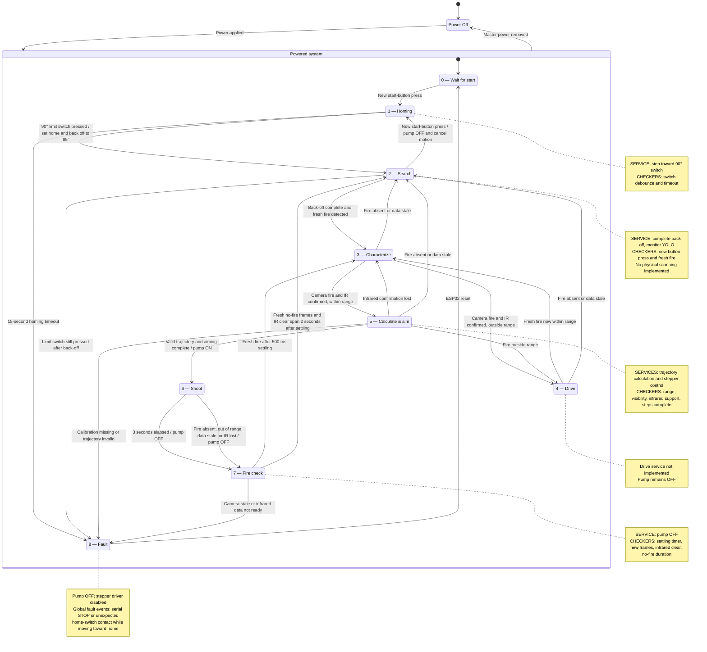

# ESP32 state machine

Arrow labels are event conditions and transition actions. Notes describe services.
Power Off is a physical system condition, not an ESP32 enum value.

- Start button: GPIO23 to GND; home switch: GPIO33 to GND; both debounced.
- A held button does not repeatedly trigger homing. Presses outside Wait/Search
  are ignored; serial START is disabled by default.
- Camera data becomes stale after 1.5 seconds; usable range is 0.10–2.00 m.
- A reset from any powered state restarts in Wait for start. Physical power-off
  requires switching the relevant supplies; software does not cut supply power.

- Characterize waits with pump off when vision and infrared disagree or the analog
  sensor is uncalibrated. IR alone does not authorize aiming or pumping.
- GPIO34 samples analog infrared intensity; it does not measure temperature.
- The average uses eight samples at 20 ms intervals, with calibrated hysteresis.
  IR-only detection in Fire check keeps the pump off and resets the clear timer.
